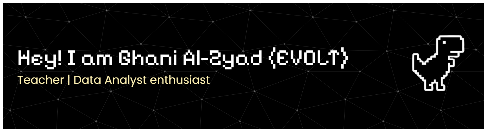

# 💫 About Me:

### Halo, saya Ghani Al-Zyad 👋  > **Guru Matematika, Koding & AI (Jenjang MA) | Data Analyst Enthusiast | Full-Stack Developer Learner**  Menjembatani logika matematika, wawasan berbasis data, dan pengembangan web modern untuk menciptakan solusi digital yang berdampak.  * **Backend & Scripting:** Python, PHP, Django, Flask, FastAPI, Laravel * **Frontend & Styling:** Next.js, React, Vite, Tailwind CSS * **Database:** MySQL, SQLite * **Data & Visualisasi:** Google Colab, Looker Studio * **Editor & Terminal:** Sublime Text 4, Git Bash 

## 🌐 Socials:
   

# 💻 Tech Stack:
                       

<!-- # 📊 GitHub Stats:
 
 
 -->

<!-- Proudly created with GPRM ( https://gprm.itsvg.in ) -->